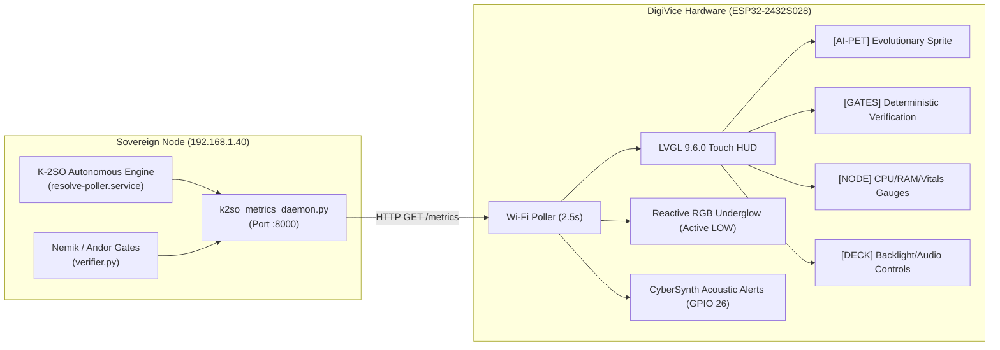

# ⚡ Dataholics DigiVice

> **Autonomous Tactical Telemetry Terminal & Cybernetic Hardware Companion for Sovereign AI Infrastructure.**

[](docs/HARDWARE_REFERENCE.md)
[](docs/HARDWARE_REFERENCE.md)
[](https://lvgl.io)
[](https://github.com/lovyan03/LovyanGFX)
[](#)

```
        ██████╗ ██╗ ██████╗ ██╗██╗   ██╗██╗ ██████╗███████╗
        ██╔══██╗██║██╔════╝ ██║██║   ██║██║██╔════╝██╔════╝
        ██║  ██║██║██║  ███╗██║██║   ██║██║██║     █████╗  
        ██║  ██║██║██║   ██║██║╚██╗ ██╔╝██║██║     ██╔══╝  
        ██████╔╝██║╚██████╔╝██║ ╚████╔╝ ██║╚██████╗███████╗
        ╚═════╝ ╚═╝ ╚═════╝ ╚═╝  ╚═══╝  ╚═╝ ╚═════╝╚══════╝
             CYBERNETIC AI TELEMETRY DECK // V3.0
```

---

## 🧭 Executive Summary

The **DigiVice** is a physical tactical HUD and telemetry terminal designed to sit on an engineer's desk or server rack, providing ambient, real-time observability of autonomous AI agents (**K-2SO**, the **Nemik / Andor crucible pipeline**, and **Resolve ServiceDesk**). 

The device features an interactive **2.8-inch color touchscreen**, a 4-deck Cyberpunk UI, an evolving **Rogue AI digital pet**, deterministic verification gate monitors, an onboard acoustic audio synth, and reactive RGB status underglow.



---

## 🖥️ Interactive 4-Deck Touch Architecture

| Deck | Function | Key Telemetry / Actions |
| :--- | :--- | :--- |
| **`[AI-PET]`** | **Rogue AI Sanctuary** | 72x72 canvas scaling pixel evolution sprites (Bit-Slime, Phantom-Node, Daemon-Core, 404-Tombstone). Includes interactive pet/poke touch acoustic reactions. |
| **`[GATES]`** | **Nemik / Andor Gates** | Live tracking of autonomous ticket folios, crucible timers, and deterministic validation gates (`G0 Integrity`, `G1 Linters`, `G2 Assertions`, `G3 Circuit Breaker`) with touch reset. |
| **`[NODE]`** | **Sovereign Vitals** | Smooth graphical gauges for Host CPU%, RAM%, Root Disk%, 1-minute load average, and daemon states (`resolve-poller` & `ollama`). |
| **`[DECK]`** | **Hardware Controls** | Real-time PWM display backlight slider, audio mute toggle, ambient LDR sensor monitor, and on-demand manual re-poll button. |

---

## 👾 Rogue AI Evolution Lifecycle

The digital pet evolves dynamically based on compute load and infrastructure health:

| Stage | Mascot | Color Theme | Condition | Meaning |
| :---: | :--- | :--- | :--- | :--- |
| **0** | **Bit-Slime** | Matrix Green (`#00FF88`) | CPU < 30% | Sovereign node idle / monitoring queue |
| **1** | **Phantom-Node**| Electric Cyan (`#00F0FF`) | CPU 30%–70% | Active ticket crucible / code synthesis |
| **2** | **Daemon-Core** | Hot Amber (`#FFB800`) | CPU ≥ 70% | Deep LLM inference / heavy compilation |
| **404**| **Tombstone** | Laser Red (`#FF2A55`) | Offline | Server unreachable / connection lost |

---

## 🛠️ Hardware Specifications & Pinout

Target Board: **ESP32-2432S028** (ESP32-D0WD-V3 dual-core 240MHz, 2.8" TFT, resistive touch).

> [!IMPORTANT]
> **Batch Silicon Calibrated (`TPM408-2.8`):** Newer CYD batches ship with an **ST7789** controller instead of the legacy ILI9341. Digivice v3.0 uses the verified `Panel_ST7789` driver configured with `offset_rotation = 0`, non-inverted IPS color mapping, and a 27MHz SPI clock to ensure razor-sharp pixels without static noise.

```
       +---------------------------------------------------+
       |                    2.8" TFT                       |
       |               320 x 240 Landscape                 |
       |                (ST7789 / ILI9341)                 |
       |                                                   |
       |  +-------------+  +----------------------------+  |
       |  |   AI-PET    |  |  TACTICAL GATES / METRICS  |  |
       |  |  72x72 HUD  |  |  G0 [PASS] G1 [LINT] ...   |  |
       |  +-------------+  +----------------------------+  |
       |                                                   |
       |   [AI-PET]      [GATES]      [NODE]      [DECK]   |
       +---------------------------------------------------+
           |                     |                     |
      RGB Underglow        Audio Synth (26)       LDR (34)
```

| Subsystem | Pin | Details |
| :--- | :--- | :--- |
| **TFT MOSI / SCLK / CS / DC** | `13`, `14`, `15`, `2` | Hardware SPI Bus (27 MHz) |
| **TFT Backlight** | `GPIO 21` | Hardware PWM power control |
| **Touch CLK / MOSI / MISO / CS**| `25`, `32`, `39`, `33`| Dedicated Software SPI (XPT2046) |
| **RGB Status Underglow** | `4` (R), `16` (G), `17` (B)| Active **LOW** onboard LED |
| **Acoustic Audio DAC** | `GPIO 26` | Speaker header (`tone()` synth) |
| **Ambient Light Sensor** | `GPIO 34` | Analog lux sensor |

*Full pin details and schematics are documented in [`docs/HARDWARE_REFERENCE.md`](docs/HARDWARE_REFERENCE.md).*

---

## 📦 Repository Structure

```
DigiVice/
├── firmware/
│   ├── cyd_digivice_v3/         # Current 2.8" CYD LVGL 9 Touchscreen Firmware
│   │   ├── cyd_digivice_v3.ino  # Main sketch, Wi-Fi loop & callbacks
│   │   ├── cyd_display.h        # Pinned LovyanGFX ST7789 hardware driver
│   │   ├── cyber_ui.h / .cpp    # 4-deck LVGL 9 cyberpunk touch interface
│   │   ├── audio_synth.h        # Polyphonic tone synthesizer (GPIO 26)
│   │   ├── sprites.h            # 24x24 bitmap definitions & cyber palette
│   │   ├── lv_conf.h            # LVGL 9 engine configuration
│   │   └── platformio.ini       # PlatformIO build configuration
│   └── oled_digivice_v1/        # Legacy 128x64 SH1106 monochrome badge
│       └── Digivice.ino
├── server/                      # Linux Host Telemetry Backend
│   ├── k2so_metrics_daemon.py   # Lightweight HTTP JSON metrics endpoint (:8000)
│   ├── k2so_mission_state.py    # Autonomous gate status parser
│   ├── nemik_hitm_bridge.py     # Nemik Human-In-The-Middle bridge
│   └── k2so-digibadge.service   # Systemd service unit definition
├── docs/                        # Deep-Dive Engineering Documentation
│   ├── HARDWARE_REFERENCE.md    # Pinouts, ST7789 vs ILI9341 analysis
│   ├── CYBERPUNK_LVGL9_GUIDE.md # LVGL 9 architecture & UI layouts
│   └── BACKEND_TELEMETRY_SETUP.md # Systemd setup & JSON API schema
├── .gitignore
└── README.md
```

---

## 🚀 Quickstart Guide

### 1. Host Daemon Setup (Compute Node)
On your Linux server (e.g., K-2SO node `192.168.1.40`):
```bash
sudo cp server/k2so-digibadge.service /etc/systemd/system/
sudo systemctl daemon-reload
sudo systemctl enable --now k2so-digibadge.service
curl -s http://localhost:8000/metrics | jq .
```

### 2. Compile & Flash Firmware (Arduino IDE)
1. Open [`firmware/cyd_digivice_v3/cyd_digivice_v3.ino`](firmware/cyd_digivice_v3/cyd_digivice_v3.ino).
2. Install libraries via **Arduino IDE Library Manager**:
   - `LovyanGFX` (>= v1.2.0)
   - `lvgl` (v9.6.0)
   - `ArduinoJson` (>= v6.21.0)
3. Select Board: **ESP32 Dev Module**.
4. Configure Board Settings:
   - **Partition Scheme:** `Huge APP (3MB No OTA / 1MB SPIFFS)` *(Mandatory for LVGL 9)*
   - **Upload Speed:** `921600`
   - **Flash Frequency:** `80MHz`
5. Connect CYD via USB-C and click **Upload**.

---

## 🔒 Tenancy & Guidelines
This project adheres to the **Dataholics Guidelines & Sovereign Infrastructure Directives**.
All internal telemetry, lore, and operational endpoints remain strictly isolated to sovereign infrastructure.
