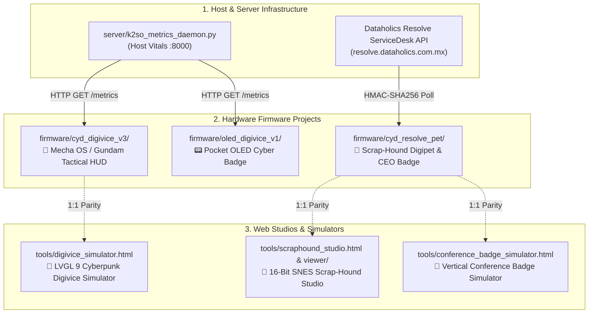

# ⚡ Dataholics DigiVice Ecosystem

> **Autonomous Cybernetic Hardware Terminals, Tactical Telemetry Companions, and Executive Digipets for Sovereign AI Infrastructure.**

[](docs/HARDWARE_REFERENCE.md)
[](docs/HARDWARE_REFERENCE.md)
[](firmware/oled_digivice_v1/)
[](#-the-projects-at-a-glance)
[](#-project-1-scraphound-resolve-digipet-firmwarecyd_resolve_pet)
[](#)

```
        ██████╗ ██╗ ██████╗ ██╗██╗   ██╗██╗ ██████╗███████╗
        ██╔══██╗██║██╔════╝ ██║██║   ██║██║██╔════╝██╔════╝
        ██║  ██║██║██║  ███╗██║██║   ██║██║██║     █████╗  
        ██║  ██║██║██║   ██║██║╚██╗ ██╔╝██║██║     ██╔══╝  
        ██████╔╝██║╚██████╔╝██║ ╚████╔╝ ██║╚██████╗███████╗
        ╚═════╝ ╚═╝ ╚═════╝ ╚═╝  ╚═══╝  ╚═╝ ╚═════╝╚══════╝
             SOVEREIGN HARDWARE ECOSYSTEM // V3.2
```

---

## 🧭 Executive Overview

The **Dataholics DigiVice Ecosystem** is a suite of dedicated physical IoT terminals, ambient desk companions, and conference badges engineered to provide real-time tactile observability of autonomous AI agents (**K-2SO**, **TiRA**, the **Nemik / Andor crucible pipeline**, and **Dataholics Resolve ServiceDesk**).

Rather than burying critical engineering operations inside browser tabs, DigiVice devices sit physically on your desk or server rack, providing ambient awareness through evolving retro sprites, acoustic alerts, underglow lighting, and interactive touch controls.

---

## 🗺️ The Projects at a Glance

The repository hosts **3 distinct firmware implementations**, **1 Python telemetry backend**, and **3 browser-based simulation studios**:



---

## 🐾 Project 1: Scrap-Hound Resolve Digipet (`firmware/cyd_resolve_pet/`)

* **Target Hardware:** ESP32-2432S028 ("CYD" 2.8" ST7789 320x240 touchscreen)
* **Graphics Engine:** LovyanGFX v1.2 (Sub-pixel buffered procedural rendering)
* **Aesthetics:** 16-Bit SNES / Early PS1 Yokai Cyber-Gremlin

### What It Is
An autonomous hardware-bound desk pet and executive conference badge tied directly into production **Dataholics Resolve ServiceDesk** (`https://resolve.dataholics.com.mx/digipet_feed.php`).

### What It Does
1. **Live Incident Tracking & Audio-Visual Mood Engine:**
   * **Ticket Opened (Alarm):** Ears perk erect, occult eye blazes blood red, two-tone klaxon sounds, and alert banner scrolls ticket title.
   * **Ticket Updated (Laugh):** Jaw chattering, wicked crescent eyes, maniacal laugh arpeggio with `HEHEHE!` comic bubble, and fuel-flame amber glow.
   * **Ticket Resolved (Chomp):** Screen shakes violently with a radioactive green/purple pulse as Scrap-Hound bites the resolved ticket in half with a metallic crunch (`CRUNCH!`).
   * **Poked (Snarl):** Center arena tap triggers a growl with bared vampire fangs (`GRRR!`).
2. **Autonomous Idle Life Simulation:**
   * While idling, Scrap-Hound roams across the industrial bunker arena, sniffs the floor, plays with an orbiting Will-o'-the-Wisp spirit flame, dozes off with heavy eyelids, and curls up in deep sleep with floating `Zzz` bubbles.
3. **Multi-Screen Touch Navigation:**
   * **Executive Badge Mode (`[ 🪪 ALONSO (CEO) ]`):** Tapping the top-left touch pill or pressing the rear physical `BOOT` button instantly transforms the device into an executive conference pass for Alonso Ruiz (CEO).
   * **Incident Deck (`SCREEN_TICKET_LIST`):** Tapping the bottom ticker banner or top metric pills opens a 4-row live incident summary with color-coded status strips.
   * **Incident Dossier (`SCREEN_TICKET_DETAIL`):** Tapping any ticket row reveals its forensic dossier (ID, status badge, priority, creator metadata, and wrapped problem description) with `< BACK TO LIST` and `RETURN TO PET 🐾` buttons.
4. **Silicon Hardware Authentication ("Zero-Scrape Protection"):**
   * Signs every request with the chip's factory eFuse MAC, a 16-hex nonce, and a UTC timestamp using **mbedtls HMAC-SHA256**. Unauthenticated requests or desktop scrapers receive HTTP 401/403. Holding touch for 3 seconds displays the Silicon eFuse Hardware Binding Card.

---

## 🤖 Project 2: Mecha OS / Gundam Tactical HUD (`firmware/cyd_digivice_v3/`)

* **Target Hardware:** ESP32-2432S028 ("CYD" 2.8" ST7789 320x240 touchscreen)
* **Graphics Engine:** LVGL v9.6.0 + LovyanGFX
* **Aesthetics:** Haute Couture Cyberpunk / Mobile Suit OS

### What It Is
A tactical terminal and mission-control dashboard monitoring autonomous AI engineering nodes (K-2SO at `192.168.1.40:8000`).

### What It Does
1. **4-Deck Cyberpunk Touch Interface:**
   * **`[AI-PET]` Deck:** Displays the evolving Gundam mobile suit frame and interactive touch reactions.
   * **`[GATES]` Deck:** Real-time tracking of the Nemik / Andor deterministic verification crucible (`G0 Integrity`, `G1 Linters`, `G2 Semantic Assertions`, `G3 Circuit Breaker`).
   * **`[NODE]` Deck:** Graphical gauges displaying Host CPU%, RAM%, Root Disk%, 1m load average, and daemon states (`resolve-poller`, `ollama`).
   * **`[DECK]` Controls:** PWM display backlight slider, audio synth mute toggle, and ambient light lux sensor monitor.
2. **Dynamic Gundam Evolution Lifecycle:**
   * **Stage 0: Proto-Gundam (CPU < 30%):** Compact SD-Gundam Core Fighter frame with cyan GN-drive underglow.
   * **Stage 1: RX-Cyber Gundam (CPU 30%–70%):** Full Mobile Suit with wide swept golden V-Fin and wing shoulder armor.
   * **Stage 2: Gundam Exia [Trans-Am Overdrive] (CPU ≥ 70%):** Magenta Trans-Am armor, emerald GN-Drive chest orb, and GN Swords.
   * **Stage 3: 404 Unit Wreck (Server Offline):** Battle-damaged head with severed antenna and electrical fault sparks.
   * **Haro AI Companion:** Spherical mascot with flapping ear-wings that pops in for incoming ticket alerts.
   * **16-Bit Scale Combat Mode (`gundam_hd_sprites.h`):** 1:1 scale combat sprites (4-frame combat idle, 4-frame dynamic stride, 2-frame melee weapon strikes from *Shin Kidou Senki Gundam: Endless Duel*).
3. **Randomized Startup Boot Sequences:**
   * Hardware RNG shuffles on power-on between three custom boots: *Option A: Mecha OS*, *Option B: Dark Editorial Split-Emblem*, and *Option C: Haro Hangar Launch*.

---

## 📟 Project 3: Pocket OLED Cyber Badge (`firmware/oled_digivice_v1/`)

* **Target Hardware:** ESP32 DevKit v1 + 0.96"–1.3" 128x64 SH1106 OLED (I2C)
* **Graphics Engine:** U8g2 Hardware Page Buffer
* **Sensors & I/O:** DHT11 (Temperature & Humidity), Piezo Buzzer, Status LEDs

### What It Is
A compact, low-power pocket badge and wearable telemetry monitor for ambient environmental and server monitoring.

### What It Does
1. **Rogue AI 4-Stage Evolution (24x24 1-Bit XBM):**
   * **Bit-Slime:** Idle data-blob.
   * **Phantom-Node:** Cloaked wraith.
   * **Daemon-Core:** High-compute seraphim.
   * **404-Ghost:** Offline tombstone.
2. **Physical Environmental Telemetry:**
   * Reads onboard DHT11 temperature and humidity sensors alongside remote server metrics.
3. **3-Mode Cycle via Pushbutton:**
   * Toggle between Rogue AI HUD, Full-Screen 2x Zoom Pet view, and Raw Server Telemetry table.

---

## 🖥️ Project 4: Host Telemetry Backend (`server/`)

* **Runtime:** Python 3.10+ on Linux compute nodes (`192.168.1.40`)
* **Service:** Systemd unit `k2so-digibadge.service`

### What It Is
The high-speed telemetry server that gathers host compute vitals and parses autonomous agent logs to feed the Digivice terminals over LAN.

### Key Components
* **`k2so_metrics_daemon.py`:** Lightweight HTTP server exposing real-time JSON metrics on port `8000`:
  ```json
  {
    "cpu": 24.5, "ram": 48.2, "disk": 61.0, "load_1m": 1.25,
    "services": { "resolve_poller": "active", "ollama": "active" },
    "active_tickets": 2, "resolved_today": 15,
    "last_ticket": { "id": 375, "title": "Strategy TMS Decommission", "status": "resolved" }
  }
  ```
* **`k2so_mission_state.py`:** Monitors autonomous ticket folios, active test cases, and gate execution times.
* **`nemik_hitm_bridge.py`:** Human-In-The-Middle supervisory socket allowing an engineer to review and approve gate verdicts directly from physical hardware.

---

## 🎨 Project 5: Interactive Web Studios & Simulators (`tools/` & `viewer/`)

To enable rapid UI iteration without flashing physical microcontrollers, the repository includes three high-fidelity web simulators:

| Studio File | Target Parity | Key Capabilities |
| :--- | :--- | :--- |
| **`tools/scraphound_studio.html`** / **`viewer/index.html`** | Scrap-Hound Digipet (`cyd_resolve_pet`) | 16-Bit SNES / Retro PS1 canvas renderer, procedural pixel engine, Web Audio API sound synth, CRT scanline filter, autonomous life behaviors, Alonso Ruiz (CEO) badge, and interactive Incident Deck navigation. |
| **`tools/digivice_simulator.html`** | Gundam Tactical HUD (`cyd_digivice_v3`) | HTML5/CSS3 replica of the 4-deck LVGL 9 touch interface with live telemetry mocking, evolution switching, and Haro alert popups. |
| **`tools/conference_badge_simulator.html`** | Conference Badge (`cyd_resolve_pet`) | Portrait 240x320 badge simulator featuring the Dataholics split-emblem animation, NFC/HMAC silicon ID preview, and executive credential cards. |

---

## 🛠️ Hardware Specification Summary (CYD 2.8")

```
       +---------------------------------------------------+
       |                    2.8" TFT                       |
       |               320 x 240 Landscape                 |
       |                (ST7789 / ILI9341)                 |
       |                                                   |
       |  [ 🪪 ALONSO (CEO) ]         ACT: 2   SLAIN: 15   |
       |  +-------------+  +----------------------------+  |
       |  |  SCRAP-HOUND|  |     INCIDENT DOSSIER       |  |
       |  |   ARENA     |  |   #375 [RESOLVED] CRITICAL |  |
       |  +-------------+  +----------------------------+  |
       |  LATEST: [TKT-375] RESOLVED            [TAP >]    |
       +---------------------------------------------------+
            |                     |                     |
       RGB Underglow        Audio Synth (26)       BOOT (GPIO 0)
```

| Pin | Function | Hardware Subsystem |
| :---: | :--- | :--- |
| **`13`, `14`, `15`, `2`** | MOSI, SCLK, CS, DC | Hardware SPI Display Bus (ST7789, 27 MHz) |
| **`GPIO 21`** | Backlight Control | Hardware PWM Power Driver |
| **`25`, `32`, `39`, `33`** | CLK, MOSI, MISO, CS | Dedicated Touch Controller SPI (XPT2046) |
| **`4`, `16`, `17`** | Red, Green, Blue | Active LOW RGB Status Underglow LED |
| **`GPIO 26`** | Audio DAC / PWM | Onboard Speaker Header (`tone()` Synthesizer) |
| **`GPIO 0`** | `BOOT` Button | Physical Tactile Switch on Rear (Toggles Executive Badge) |
| **`GPIO 34`** | Light Sensor | Ambient Photoresistor (LDR ADC) |

---

## 🔒 Tenancy & Guidelines

This project strictly adheres to the **Dataholics Guidelines & Sovereign Infrastructure Directives**.
* Internal Dataholics metrics, server telemetry, and agent states reside strictly on internal sovereign infrastructure (`192.168.1.40`, `devresolve.dataholics.com.mx`).
* Client projects (Warhorse, BQS, Border Built, Decoglobos) remain completely isolated.
* External API calls from devices enforce cryptographic silicon eFuse tokens with time-windowed HMAC-SHA256 signatures.
