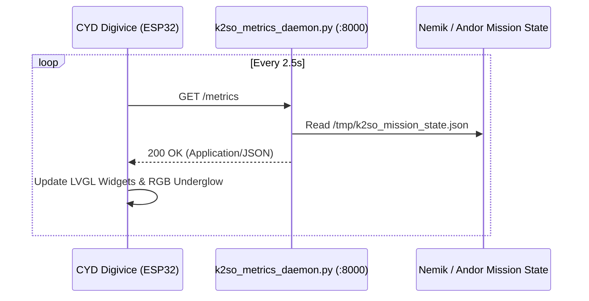

# Backend Telemetry Setup & JSON Protocol

## Overview
The Digivice connects over 2.4GHz Wi-Fi and queries the sovereign server (e.g., K-2SO node at `http://192.168.1.40:8000/metrics`) via lightweight non-blocking HTTP GET requests every 2.5 seconds.



---

## 🚀 Server Installation (Linux / systemd)

1. **Deploy Daemon Files:**
   Copy the `server/` directory to `/opt/k2so-metrics/` on the host machine:
   ```bash
   sudo mkdir -p /opt/k2so-metrics
   sudo cp server/k2so_metrics_daemon.py /opt/k2so-metrics/
   sudo cp server/k2so_mission_state.py /opt/k2so-metrics/
   ```

2. **Install Python Dependencies:**
   ```bash
   pip install psutil
   ```

3. **Install Systemd Service Unit:**
   Copy the unit file:
   ```bash
   sudo cp server/k2so-digibadge.service /etc/systemd/system/
   sudo systemctl daemon-reload
   sudo systemctl enable --now k2so-digibadge.service
   ```

4. **Verify Health:**
   ```bash
   curl -s http://localhost:8000/metrics | jq .
   ```

---

## 📡 JSON Telemetry Schema

The `/metrics` endpoint returns a unified payload containing system vitals, service health, and the active Nemik/Andor crucible mission:

```json
{
  "cpu": 42.5,
  "ram": 58.2,
  "disk": 34.0,
  "load_1m": 1.45,
  "uptime_sec": 142800,
  "poller": "active",
  "ollama": "active",
  "mission": {
    "active": true,
    "protocol": "ANDOR_INVERTED",
    "ticket_id": 308,
    "ticket_folio": "TK-308",
    "stage": "GATE_2_ASSERTIONS",
    "attempt": 1,
    "circuit_breaker": false,
    "elapsed_sec": 48.2,
    "gates": {
      "g0": "PASS",
      "g1": "PASS",
      "g2": "IN_FLIGHT",
      "g3": "ARMED"
    }
  }
}
```

### Telemetry Field Dictionary

| Key | Type | Description |
| :--- | :--- | :--- |
| `cpu` | `float` | Current CPU utilization percentage (0.0 – 100.0) |
| `ram` | `float` | Current RAM memory usage percentage (0.0 – 100.0) |
| `disk` | `float` | Root partition storage utilization percentage |
| `load_1m` | `float` | Unix 1-minute load average |
| `uptime_sec` | `integer`| Host uptime in seconds |
| `poller` | `string` | Systemd status for `resolve-poller.service` (`active`/`inactive`) |
| `ollama` | `string` | Systemd status for `ollama.service` (`active`/`inactive`) |
| `mission.active` | `bool` | Whether an autonomous engineering task is executing |
| `mission.protocol` | `string` | Execution protocol name (`CASSIAN`, `ANDOR_INVERTED`, `STANDBY`) |
| `mission.ticket_id`| `int` | Current ticket ID in Resolve DB |
| `mission.ticket_folio`| `string`| Human-readable ticket folio |
| `mission.stage` | `string` | Current crucible phase (`DISCOVERY`, `PATCHING`, `GATE_VERIFY`) |
| `mission.circuit_breaker` | `bool` | True if circuit breaker has tripped, disabling autonomous deploys |
| `mission.gates.g0` | `string` | Gate 0 state: `PASS`, `FAIL`, `IN_FLIGHT`, or `IDLE` |
| `mission.gates.g1` | `string` | Gate 1 state: Pre-flight syntax linters |
| `mission.gates.g2` | `string` | Gate 2 state: Deterministic test assertions |
| `mission.gates.g3` | `string` | Gate 3 state: Circuit breaker / safety latch |
