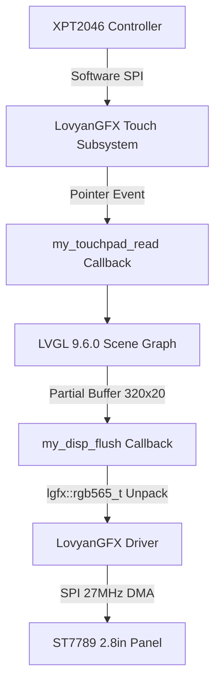

# Cyberpunk LVGL 9.x Interface & Audio Architecture

## Overview
Digivice v3.0 runs a full custom cybernetic heads-up display built on **LVGL v9.6.0** with high-speed SPI rendering orchestrated by **LovyanGFX**.



---

## 🖥️ 4-Deck Interactive Touch Architecture

The interface uses a bottom-mounted cyber navigation bar switching across 4 specialized tactical decks:

```
+-------------------------------------------------------------+
| [K-2SO HOST] 192.168.1.40         WIFI: -54 dBm  UP: 14h 22m| (Top Bar)
+-------------------------------------------------------------+
|                                                             |
|   Deck Area (320 x 176 px)                                  |
|   - AI Pet Sanctuary                                        |
|   - Tactical Mission & Deterministic Gates                  |
|   - Node Vitals Matrix                                      |
|   - Control Deck                                            |
|                                                             |
+-------------------------------------------------------------+
|  [AI-PET]   |   [GATES]   |    [NODE]    |     [DECK]       | (Bottom Nav)
+-------------------------------------------------------------+
```

### 1. `[AI-PET]` Deck: Rogue AI Evolution Sanctuary
- Displays an interactive **72x72 scaled pixel sprite** on a dedicated LVGL canvas.
- Dynamically morphs depending on the sovereign host's CPU and online status:
  - **Stage 0: Bit-Slime** (Green `#00FF88`, CPU < 30% Idle)
  - **Stage 1: Phantom-Node** (Electric Cyan `#00F0FF`, CPU 30%–70% Active Crucible)
  - **Stage 2: Daemon-Core** (Hot Amber `#FFB800`, CPU ≥ 70% Overload Execution)
  - **Stage 404: Tombstone Ghost** (Crimson `#FF2A55`, Server Offline / Unreachable)
- **Touch Interaction:** Tapping the sprite card triggers an acoustic pet chirp and an instant manual telemetry re-poll.

### 2. `[GATES]` Deck: Tactical Nemik / Andor Crucible Monitor
Tracks live autonomous engineering missions dispatched by the Cassian / Andor protocols:
- **Active Folio & Protocol:** E.g., `TK-308 (ANDOR_INVERTED)`
- **Crucible Stage & Elapsed Clock:** Real-time execution timer.
- **Deterministic Gate Cards:**
  - `G0: INTEGRITY` — Patch syntax, no git merge markers, non-empty.
  - `G1: LINTERS` — Pre-flight linter validation (`tsc`, `php -l`).
  - `G2: ASSERTIONS` — Automated unit/regression pass criteria.
  - `G3: BREAKER` — Safety circuit breaker state.
- **Acknowledge Button:** An interactive touch button `[ ACK / RESET CIRCUIT ]` allows on-screen acknowledgement and manual re-engagement if a circuit breaker is tripped.

### 3. `[NODE]` Deck: Sovereign Vitals Matrix
Real-time gauges and terminal telemetry for the remote compute node:
- **CPU Load Bar & Percent:** Smoothly animated gradient progress bar.
- **RAM Usage Bar & Percent:** Memory pressure indicator.
- **Disk Usage Bar & Percent:** Root filesystem telemetry.
- **System Load Average (1m):** Real-time Unix load average.
- **Daemon Heartbeats:** Live statuses for `resolve-poller.service` and `ollama.service`.

### 4. `[DECK]` Deck: Hardware Console
- **PWM Backlight Slider:** Real-time 0–100% display brightness control.
- **Audio Mute Switch:** Interactive toggle enabling/disabling onboard sound effects.
- **Ambient Light Sensor:** Live Lux/ADC readout from GPIO 34.
- **Instant Re-Poll Trigger:** One-click manual HTTP telemetry sync.

---

## 🔊 CyberSynth Audio Engine (GPIO 26)

The firmware includes a zero-dependency acoustic synthesizer using ESP32 PWM `tone()` commands on the onboard speaker header:

| Sound Routine | Acoustic Pattern | Trigger Event |
| :--- | :--- | :--- |
| **Boot Chirp** | 880Hz → 1760Hz rising chirp (60ms) | Initial hardware boot |
| **Evolution Fanfare** | 4-tone ascending cyber arpeggio (C5 → E5 → G5 → C6) | AI evolution stage up |
| **Gate Pass Chime** | Dual crystal bell (1318Hz → 1760Hz) | Gate test passed |
| **Circuit Breaker Alert**| Alternating 440Hz / 880Hz klaxon (3 cycles) | Circuit breaker tripped |
| **Touch Poke Feedback** | High 2200Hz micro-click (20ms) | Touch button actuation |
